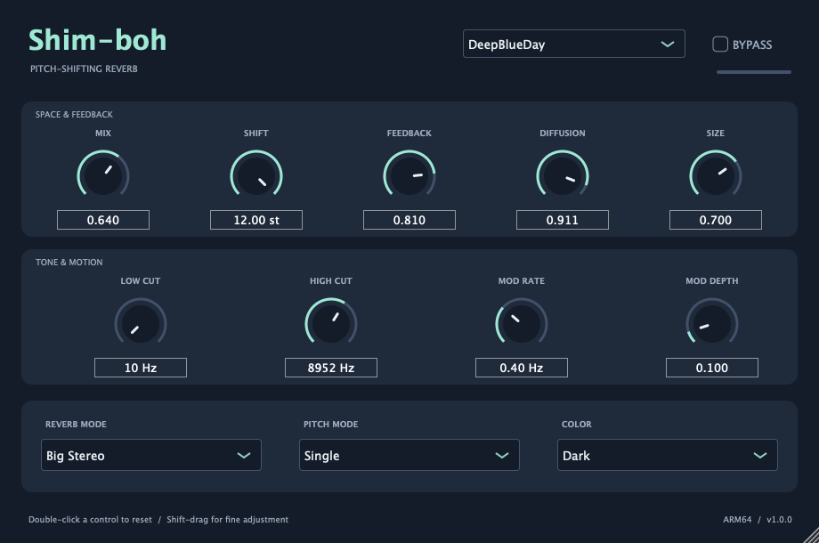

# Shim-boh

Riverbero shimmer **gratuito** in formato VST3 per **macOS 11 o successivo e Apple Silicon (ARM64)**.

[Scarica Shim-boh 1.0.0](https://github.com/vallaproductionsoriginal-byte/Shim-boh/releases/download/v1.0.0/Shim-boh-1.0.0-macOS-arm64.zip) · [Tutte le release](https://github.com/vallaproductionsoriginal-byte/Shim-boh/releases)

## Installazione

1. Scarica ed estrai lo ZIP della release.
2. Copia **l'intera cartella** `Shim-boh.vst3` in `~/Library/Audio/Plug-Ins/VST3/`. In Finder puoi raggiungere la cartella con **Vai → Vai alla cartella**.
3. Riavvia la DAW o ripeti la scansione VST3.
4. Cerca **Shim-boh**, produttore **Francesco**, categoria **Reverb**.

Avvia la DAW in modalità Apple Silicon. Questa versione non include build Intel, Windows, Audio Unit o un'applicazione standalone.

Il bundle è firmato ad hoc, non notarizzato e non firmato con un certificato Developer ID. macOS o la DAW possono richiedere l'autorizzazione al caricamento del plugin; una firma ad hoc non equivale a una verifica Apple.

## Funzioni

- Mix, Shift da −12 a +12 semitoni, Feedback, Diffusion e Size.
- Low Cut 10–2000 Hz, High Cut 1000–20000 Hz, Mod Rate 0.02–10 Hz e Mod Depth.
- Riverbero Mono, Small Stereo, Medium Stereo e Big Stereo.
- Pitch Single, Dual, Single Reverse, Dual Reverse e Bypass, inserito nel feedback del riverbero.
- Color Bright/Dark, bypass del plugin, automazione dei 13 parametri e salvataggio/ripristino della sessione.
- Otto preset: BlackHole, ConcertHall, BrightHall, DeepBlueDay, Chorus, BigReverse, TajMahal, OctaveUpDown.
- Ingresso/uscita stereo, mono e mono→stereo. Interfaccia ridimensionabile.

## Uso

Per un aux/send, imposta Mix a 1.00. Per lo shimmer, parti da DeepBlueDay, Shift +12 e Feedback 0.7–0.9. Per un riverbero senza pitch scegli Pitch Mode Bypass.

Il bypass del pitch mantiene il riverbero attivo; BYPASS in alto disattiva l'effetto. L'uscita dry resta senza latenza; la componente wet ha il ritardo naturale della rete di riverbero e dei grani.

## Distribuzione e licenza

Questo repository pubblica il plugin compilato e la documentazione. Il codice sorgente non viene distribuito. Lo ZIP della release contiene il bundle VST3, con licenza e avvisi delle dipendenze nelle sue risorse.

Le parti originali di Shim-boh e la documentazione sono concesse sotto **licenza MIT**, riportata in [LICENSE](LICENSE). L'assenza dei sorgenti non limita i permessi MIT sulle parti originali distribuite.

**JUCE e le altre dipendenze mantengono le proprie licenze e non sono rilicenziate MIT da questo progetto.** JUCE è utilizzato con licenza commerciale JUCE Starter. I relativi avvisi e i testi delle licenze sono in [THIRD_PARTY_NOTICES.md](THIRD_PARTY_NOTICES.md) e nelle risorse del plugin.

Per problemi o incompatibilità, apri una [issue](https://github.com/vallaproductionsoriginal-byte/Shim-boh/issues) indicando versione di macOS, DAW e versione del plugin.
